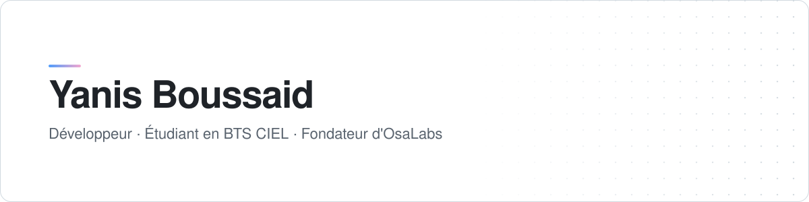

<picture>
  <source media="(prefers-color-scheme: dark)" srcset=".github/assets/banner-dark.svg" />
  
</picture>

 

Étudiant en **BTS CIEL** en alternance au sein d'un service informatique, je développe en parallèle **OsaLabs** : une suite d'applications macOS natives et d'outils web temps réel, conçus, déployés et maintenus de bout en bout, du code jusqu'au serveur.

  

## Projets

#### Applications macOS

| Projet | Description | Stack |
|---|---|---|
| [OsaNotch](https://github.com/osayanis/osanotch-native) | Transforme l'encoche du MacBook en espace utile : lecteur avec paroles synchronisées, étagère de fichiers, HUD système. | Swift · SwiftUI · AppKit |
| [OsaHUB](https://github.com/osayanis/osahub) | Installe et met à jour toutes les apps OsaLabs depuis un seul endroit. | Swift · SwiftUI |
| [OsaBoot](https://github.com/osayanis/osaboot) | Crée une clé USB démarrable depuis macOS, y compris à partir d'une ISO Windows. | Swift · wimlib |
| [OsaWallpaper](https://github.com/osayanis/osawallpaper) | Adapte l'écran verrouillé du Mac aux couleurs de la musique en cours. | Swift |

#### Web et temps réel

| Projet | Description | Stack |
|---|---|---|
| [OsaDrop](https://github.com/osayanis/osadrop) | Transfert de fichiers pair-à-pair, sans compte ni stockage serveur. | WebRTC · Next.js |
| [OsaParty](https://github.com/osayanis/osaparty) | Écoute synchronisée Apple Music et Spotify entre amis, par code PIN ou QR code. | Next.js · Socket.io |
| [OsaMaps](https://github.com/osayanis/osamaps) | Application de navigation (PWA et app iOS). | TypeScript · Swift |
| [Clavio](https://github.com/osayanis/clavio) | Apprentissage du piano en Web MIDI : leçons progressives et import de fichiers MIDI. | JavaScript |

#### Systèmes et infrastructure

| Projet | Description | Stack |
|---|---|---|
| [EraseKEY](https://github.com/osayanis/erasekey) | Clé USB amorçable qui efface complètement les disques d'un PC, avec une interface console en français. | Go · Bubble Tea |
| [OsaTV](https://github.com/osayanis/osatv) | Écran d'accueil sur mesure pour Android TV. | Kotlin · Compose for TV |
| [Proxmox Automatisation](https://github.com/osayanis/Proxmox-Automatisation-Script) | Provisionnement en masse de conteneurs et de VM sur Proxmox VE. | Bash |
| OpenPod OS | Système Linux embarqué pour un baladeur audio sur Raspberry Pi Zero 2 W, co-développé. *En cours.* | Linux embarqué |

## Technologies

  

L'ensemble d'OsaLabs tourne sur un VPS Linux que j'administre moi-même : Nginx, PM2, certificats TLS et accès SSH par clé uniquement.
